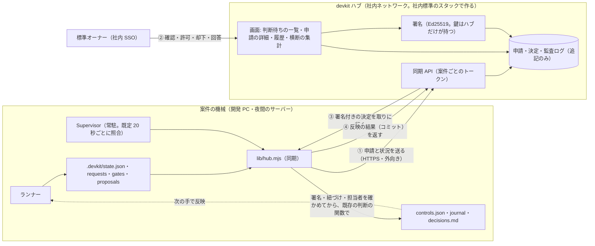

# ADR-0008: 標準オーナー向けのサブシステム（devkit ハブ）。社内ネットワークから各案件の申請を確認・許可・記録する方法の検討

- 状態: 提案（検討中。標準オーナーの判断待ち）
- 日付: 2026-11-10
- 関連: ADR-0003（人の決定を controls.json に分ける）、ADR-0006（Supervisor）、ADR-0007（GUI）

## 背景

4.3.0 では、標準オーナーの判断はすべて「その案件のリポジトリの端末」で行う。

| 標準オーナーの判断 | 今のコマンド | 今の記録 |
| --- | --- | --- |
| 計画の技術承認・マイルストーンの技術承認・着手前の承認 | `approve … --role 技術` | `controls.json`・`docs/decisions.md` |
| 技術の判断依頼（ESC-01・02・05）への回答 | `answer <ノード> --role 技術 --request <ID>` | 同上 |
| 再計画の案の承認・却下 | `proposal accept\|reject` | 同上 |
| 標準の例外の登録 | `exception add …` | `docs/exceptions.json`・ADR |
| 上限の追加・Supervisor の解除・記録の受け入れ | `resume --add-cycles`・`supervisor clear`・`seal accept` | 同上 |

案件が増えると、次が問題になる。

1. **標準オーナーが案件ごとの機械に入る必要がある。** 判断には、その案件の作業ツリーと、`docs/profile.json` の担当者と同じ git のメールが要る。夜間の機械で回している案件は SSH で入ることになる。
2. **横断の一覧がない。** だれの判断待ちが何件あるか、どの案件で同じ例外が出ているかは、案件ごとに `status` や `decisions.md` を見ないと分からない。「同じ例外が3案件以上で出たら標準を改訂する」（05-exceptions.md）は、人の記憶に頼っている。
3. **本人の確認が弱い。** 判断者の照合は git の `user.email`（自己申告）で、同じ利用者の権限で動くプログラムを完全には見分けられない（rollout.md の 7 に明記している残余の危険）。
4. **申請という形がない。** 利用者が例外を求めるときは、標準オーナーに口頭やチャットで頼み、標準オーナーが案件の端末で登録する。依頼・審査・結果の履歴が1か所に残らない。

## 変えないこと

- AI（対話の Claude・ランナーが起動した AI）は、人の判断を出せない。
- 判断は、計画のハッシュ・検証したコミット・判断依頼の ID・ノードの定義に紐づき、役割は受け付けるときと反映するときの両方で確かめる。
- 案件の状態に書くのは、案件の中の devkit のコード（`controls.json` → ランナーが反映、journal、`decisions.md`）だけ。**ハブは案件のリポジトリにも機械にも直接は書かない。**
- 例外は案件の中だけで有効。標準そのものの改訂は、プラグインのリポジトリで行って版として配る。
- 端末のコマンドは残す。ハブが落ちていても、今までどおり判断できる。

## 検討した選択肢

| 選択肢 | 良い点 | 悪い点 |
| --- | --- | --- |
| A. GitHub だけで行う（申請を Issue・PR にし、CODEOWNERS のレビューを許可とする） | サーバーが要らない。本人の確認は GitHub。CODEOWNERS はすでに必須 | レビューの承認だけではランナーが進まない（`controls.json` と journal に書く経路が要る）。Actions に書かせると、案件の外に新しい書き込みの経路ができる。業務担当者に GitHub のアカウントと操作を求める。横断の一覧は別に作ることになる |
| B. 共有の申請リポジトリ（案件が申請ファイルを push し、標準オーナーが署名付きコミットで答える） | サーバーが軽い。履歴が git | 画面がなく、確認資料（画面写真・差分）を見づらい。署名鍵を各自が管理する。通知・検索・集計を別に作る |
| C. ハブが案件の機械に入って devkit のコマンドを実行する（SSH・エージェントへの push） | 案件の側の変更が少ない | ハブが全案件の機械に入れる権限を持つ。ノート PC・NAT の内側に届かない。ハブが破られると全案件に書ける |
| **D. 社内ネットワークのハブ＋案件からの取りに行く同期＋署名付きの決定（採用の案）** | 接続は案件から外向きだけ。本人の確認は社内 SSO。決定は署名で確かめるので、案件の機械の AI には作れない。横断の一覧・集計・履歴を1か所に持てる | サーバーと DB と鍵の運用が増える。ハブの署名鍵が新しい信頼の中心になる |

## 提案する構成



### 案件の側（`runtime/scripts/devkit/lib/hub.mjs`。依存パッケージなし）

1. **申請を出す。** Supervisor の照合のたびに、`decide()` の判断待ち（承認・回答・再計画の案）と Supervisor の停止を、申請としてハブに送る。申請の ID は、既存の紐づけから決める（計画はハッシュ、マイルストーンは `<ID>@<検証したコミット>`、判断依頼は依頼の ID、着手前はノードの定義のキー）。同じ ID は2回作らない。添付は、確認資料（`.devkit/gates/<ID>.html`）・判断依頼の本文・再計画の案の差分・ブリーフィング。秘密値の形の文字列は、ブリーフィングと同じ処理で伏せる。
2. **例外の申請。** 新しいコマンド `pnpm devkit exception request --rules … --subject … --reason … --adr … --review-by …`（だれでも。Claude からも）。`.devkit/hub/outbox/` に申請を書くだけで、`docs/exceptions.json` には触れない。`devkit-standard-exception` スキルは、ADR の下書きとこの申請までを行う。
3. **決定を取りに行って反映する。** 決定（下の「決定の封筒」）を受け取ったら、次をすべて確かめる。1つでも合わなければ反映せず、理由をハブに返す。
   - 署名が、`docs/standard/hub.json` の公開鍵（鍵 ID で選ぶ）で検証できる
   - 案件の ID が自分のもの、期限の内、同じ決定をまだ反映していない
   - 紐づけが今の状態と同じ（計画のハッシュ・検証したコミット・依頼の ID・ノードの定義）。古い版への決定は捨てる
   - 決定した人のメールが `docs/profile.json` の `owners.<役割>` にいる（代理はハブの上で本人が指名した記録があるときだけ）
   - 役割が、その判断に要る役割である（既存の `requiredRoles`・`requestRole`・`proposalNeededRoles`）
4. **反映は既存の関数で。** 端末のコマンドと同じ関数（ADR-0007 の「判断の関数の切り出し」）を呼び、`controls.json`・journal（`command: "hub approve"` と封筒のハッシュ）・`decisions.md`（内容の欄に「ハブ経由・申請の ID」）に書く。封筒は `.devkit/hub/decisions/<ID>.json` に保存してコミットする（後から git だけで署名を検証できる）。
5. Supervisor が動いていない案件は、`pnpm devkit hub sync` を手で実行する（表示と同期だけ。判断は出せない）。

### 決定の封筒

```json
{
  "v": 1, "keyId": "hub-2026-11", "id": "DEC-000123",
  "project": "equipment", "application": "M2@3f9c2a71d0",
  "kind": "approve-milestone", "target": "M2", "binding": { "sha": "3f9c2a71d0…" },
  "decision": "approve", "role": "technical", "note": "外部接続は externalHosts の登録を確認",
  "by": { "name": "技術 花子", "email": "hanako@example.co.jp", "sub": "<SSO の利用者 ID>" },
  "at": "2026-11-10T08:41:12+09:00", "expiresAt": "2026-11-17T08:41:12+09:00",
  "sig": "<Ed25519(正規化した JSON)>"
}
```

`kind` は `approve-plan`・`approve-milestone`・`approve-before`・`reject-milestone`・`answer`・`proposal-accept`・`proposal-reject`・`exception-add`。

### ハブ（新しいアプリ。このリポジトリの `apps/hub/`）

- **社内標準のスタックで作る**（Next.js・Drizzle・PostgreSQL・Better Auth の OIDC・`defineAction`・権限表・監査ログ）。devkit の雛形から作り、devkit で開発する。標準オーナーが保守できる形で、標準と雛形の実地の検証にもなる。
- **画面**
  - 判断待ちの一覧（全案件。役割・種別・待ち時間・ランナーが止まっているかで並べ替え）
  - 申請の詳細（何を・なぜ・選択肢とおすすめ・対象の版・確認資料・変更検出のフラグ・リリース前検査の結果）と、許可・却下・回答（理由は必須）
  - 例外の台帳（全案件。ルール・対象・見直し期限。期限が近いものの一覧）
  - 履歴（決定・反映の結果・断られた決定とその理由。案件・人・ルール・期間で検索、CSV で書き出し）
  - 横断の集計（同じルール・対象の例外が3案件以上 → 標準の改訂の候補。判断の所要時間。止まる条件ごとの件数）。`devkit-standard-feedback` の材料にする
  - 案件の登録（案件のトークンの発行・失効）と、担当者・代理の指名
- **権限**: 標準オーナー（技術の判断）、業務担当者（自分の案件の業務の判断。第3段階）、閲覧者、ハブの管理者（案件の登録・鍵の入れ替え）。案件ごとの担当者は `docs/profile.json` を正とし、ハブは同期で受け取った写しと SSO のメールを照合する。
- **AI が書いた内容の表示**: 申請の本文・確認資料・ログは AI が作ったもの。文字としてだけ表示し、確認資料の HTML はスクリプトと同一オリジンを許さない `iframe sandbox` で見せる（画面の中の文字列が許可のボタンを押せないようにする）。CSP でインラインのスクリプトを許さない。
- **監査ログ**: 追記のみの表（前の行のハッシュを含める）。申請の受け付け・表示・決定・封筒の発行・案件からの反映の結果・断られた理由を残す。日ごとに先頭のハッシュを別の場所に書き出す。
- **通知**: 新しい申請・見直し期限の接近・反映の失敗を、標準オーナーに送る（メール・Slack）。通知のリンクはハブの画面に飛ぶだけで、**通知への返信では決定にならない**。

### 信頼の境界

| 危険 | 対策 |
| --- | --- |
| 案件の機械の AI が、決定を偽造する | 決定は署名付き。秘密鍵はハブだけにあり、案件には公開鍵（`docs/standard/hub.json`。封印の対象で、標準の版と一緒に配る）だけ |
| 古い決定・別の案件の決定の使い回し | 案件の ID・紐づけ・期限・1回だけの反映を、案件の側で確かめる |
| 申請のなりすまし（偽の申請を送る） | 案件ごとのトークン（リポジトリの外。Supervisor の環境変数）。偽の申請は一覧を汚すだけで、決定は紐づけが合わなければ反映されない |
| ハブが破られる | 決定を偽造できるのは「紐づけが今の状態と合い、担当者が profile にいる」範囲に限られる。案件の git に封筒が残るので、後から突き合わせられる。CODEOWNERS とブランチ保護は引き続き必須。さらに強くするなら、ハブの鍵ではなく決定者の個人の鍵（WebAuthn のパスキー）で署名する（下の「決めること」） |
| ハブが落ちる | 端末のコマンドで判断できる。同期は失敗を数えて間隔をあけ、ランナーは止めない |
| 社内ネットワークに届かない実行環境（クラウドのセッションなど） | 同期できないので、端末のコマンドを使う。ハブの接続先は設定（`.devkit/config.json` の `hub.url`）で、なければ何もしない |

ADR-0006 の「通知の返信だけで承認済みにはしない（判断は既存の CLI だけ）」は、「判断は既存の CLI か、署名を検証したハブの決定だけ」に改める。Supervisor の起動の条件（判断を反映した写しの状態で、実行できる作業がある）は変えない。

### ハブで受け付けないもの（端末のまま）

- リリースの技術承認の `--force`（リリース前検査が未達のままの承認）
- `seal accept`・`supervisor clear`・`resume --add-cycles`（その機械の状態を確かめてから行う判断。ハブには表示と通知だけ）
- `docs/profile.json`（担当者）と `.devkit/config.json`（隔離・上限）の変更

## 段階

| 段階 | 入れるもの | 信頼の変化 |
| --- | --- | --- |
| 0 | 判断の関数の切り出し（ADR-0007 と共通）。`hub.json`・封筒の形式・検証の関数とテスト | なし |
| 1 | 読み取りだけのハブ: 案件が申請と状況を送り、標準オーナーが横断の一覧・履歴・例外の台帳を見る。判断は今までどおり端末（ハブはコマンドを表示する）。`exception request` | なし（新しい判断の経路を作らない） |
| 2 | 標準オーナーの署名付きの決定: 例外・技術の判断依頼・技術の承認・再計画の案 | ハブの鍵が信頼の中心に加わる |
| 3 | 業務担当者の決定（業務ゲート・業務の判断依頼）。通知のリンクから確認資料を見て承認する | 業務担当者が端末を使わなくなる |
| 4 | 個人の鍵での署名（WebAuthn）、標準の改訂の PR の下書きの生成 | ハブが破られても決定を偽造できない |

段階1だけでも、「横断の一覧」「申請の形」「例外の台帳と期限の管理」「3案件以上の検出」が手に入る。段階2に進むかは、段階1の運用（申請の件数・判断の所要時間・同期の失敗）を見てから決める。

## 決めること（標準オーナー）

1. ハブを置く場所と運用の担当（社内のサーバー・VM、DB のバックアップ、TLS の証明書）。
2. 社内 SSO の種類（Microsoft Entra ID か Google Workspace）と、標準オーナーを表すグループ。
3. 署名鍵の持ち方: ハブの鍵（初期の案。置き場所と入れ替えの手順）か、最初から個人の鍵（WebAuthn）か。
4. 添付の範囲: 確認資料・画面写真・差分をハブに置いてよいか（個人情報を扱う案件は要約だけにする設定を既定にするか）。
5. 業務担当者もハブで判断するか（段階3）、技術だけにするか。
6. 履歴の保存期間と、監査のための書き出し先。

## 影響

- 案件: `docs/standard/hub.json`（公開鍵・鍵 ID）、`.devkit/config.json` の `hub`（`url`・`materials`）、`.devkit/hub/`（送信待ち・受け取った封筒）、`DEVKIT_HUB_TOKEN`（環境変数）。ガードに、`.devkit/hub/decisions/` の編集と、ハブの API への Claude からの書き込みを止める規則を足す。
- プラグイン: `devkit-standard-exception`・`devkit-gate-review`・`devkit-status` に、ハブがあるときの案内を足す。
- このリポジトリ: `apps/hub/` と、その CI・配置の手順（`docs/rollout.md` に章を足す）。
- 元に戻す方法: `hub.url` を消す。同期をやめるだけで、判断は端末に戻る。反映済みの決定は `controls.json` と `decisions.md` に残る。
