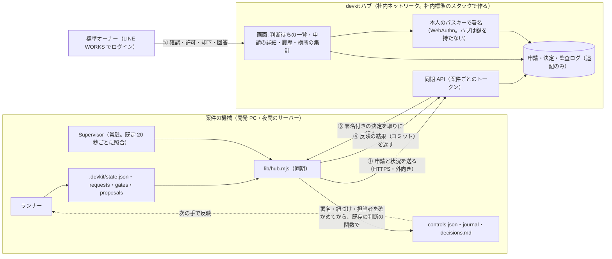

# ADR-0008: 標準オーナー向けのサブシステム（devkit ハブ）。社内ネットワークから各案件の申請を確認・許可・記録する方法の検討

- 状態: 方針決定（2026-11-10。実装前。下の「決定したこと」）
- 日付: 2026-11-10
- 関連: ADR-0003（人の決定を controls.json に分ける）、ADR-0006（Supervisor）、ADR-0007（GUI）

## 背景

4.3.0 では、標準オーナーの判断はすべて「その案件のリポジトリの端末」で行う。

| 標準オーナーの判断 | 今のコマンド | 今の記録 |
| --- | --- | --- |
| 計画の技術承認・マイルストーンの技術承認・着手前の承認 | `approve … --role 技術` | `controls.json`・`docs/decisions.md` |
| 技術の判断依頼（ESC-01・02・05）への回答 | `answer <ノード> --role 技術 --request <ID>` | 同上 |
| 再計画の案の承認・却下 | `proposal accept\|reject` | 同上 |
| 標準の例外の登録 | `exception add …` | `docs/exceptions.json`・ADR |
| 上限の追加・Supervisor の解除・記録の受け入れ | `resume --add-cycles`・`supervisor clear`・`seal accept` | 同上 |

案件が増えると、次が問題になる。

1. **標準オーナーが案件ごとの機械に入る必要がある。** 判断には、その案件の作業ツリーと、`docs/profile.json` の担当者と同じ git のメールが要る。夜間の機械で回している案件は SSH で入ることになる。
2. **横断の一覧がない。** だれの判断待ちが何件あるか、どの案件で同じ例外が出ているかは、案件ごとに `status` や `decisions.md` を見ないと分からない。「同じ例外が3案件以上で出たら標準を改訂する」（05-exceptions.md）は、人の記憶に頼っている。
3. **本人の確認が弱い。** 判断者の照合は git の `user.email`（自己申告）で、同じ利用者の権限で動くプログラムを完全には見分けられない（rollout.md の 7 に明記している残余の危険）。
4. **申請という形がない。** 利用者が例外を求めるときは、標準オーナーに口頭やチャットで頼み、標準オーナーが案件の端末で登録する。依頼・審査・結果の履歴が1か所に残らない。

## 変えないこと

- AI（対話の Claude・ランナーが起動した AI）は、人の判断を出せない。
- 判断は、計画のハッシュ・検証したコミット・判断依頼の ID・ノードの定義に紐づき、役割は受け付けるときと反映するときの両方で確かめる。
- 案件の状態に書くのは、案件の中の devkit のコード（`controls.json` → ランナーが反映、journal、`decisions.md`）だけ。**ハブは案件のリポジトリにも機械にも直接は書かない。**
- 例外は案件の中だけで有効。標準そのものの改訂は、プラグインのリポジトリで行って版として配る。
- 端末のコマンドは残す。ハブが落ちていても、今までどおり判断できる。

## 検討した選択肢

| 選択肢 | 良い点 | 悪い点 |
| --- | --- | --- |
| A. GitHub だけで行う（申請を Issue・PR にし、CODEOWNERS のレビューを許可とする） | サーバーが要らない。本人の確認は GitHub。CODEOWNERS はすでに必須 | レビューの承認だけではランナーが進まない（`controls.json` と journal に書く経路が要る）。Actions に書かせると、案件の外に新しい書き込みの経路ができる。業務担当者に GitHub のアカウントと操作を求める。横断の一覧は別に作ることになる |
| B. 共有の申請リポジトリ（案件が申請ファイルを push し、標準オーナーが署名付きコミットで答える） | サーバーが軽い。履歴が git | 画面がなく、確認資料（画面写真・差分）を見づらい。署名鍵を各自が管理する。通知・検索・集計を別に作る |
| C. ハブが案件の機械に入って devkit のコマンドを実行する（SSH・エージェントへの push） | 案件の側の変更が少ない | ハブが全案件の機械に入れる権限を持つ。ノート PC・NAT の内側に届かない。ハブが破られると全案件に書ける |
| **D. 社内ネットワークのハブ＋案件からの取りに行く同期＋署名付きの決定（採用）** | 接続は案件から外向きだけ。本人の確認は社内 SSO。決定は署名で確かめるので、案件の機械の AI には作れない。横断の一覧・集計・履歴を1か所に持てる | サーバーと DB の運用が増える |

## 決定したこと（2026-11-10）

| 項目 | 決定 |
| --- | --- |
| ハブで判断する人 | **標準オーナー（技術の判断）だけ。** 業務担当者は、案件の機械のローカルのコンソールで判断する（ADR-0007） |
| 置き場所 | 社内のサーバー（社内ネットワークの中だけ） |
| ログイン | **LINE WORKS**（OAuth 2.0 + OpenID Connect。下の「LINE WORKS でのログイン」） |
| 署名 | **最初から、判断する本人のパスキー（WebAuthn）。** ハブは署名鍵を持たない |
| 添付 | 確認資料・画面写真・差分を、ハブに置いてよい |
| 設定などの変更 | 変更が要る申請には**変更案を付けて見せ、承認されたら案件の側で自動で当てる**（下の「変更案」） |

## 提案する構成



### 案件の側（`runtime/scripts/devkit/lib/hub.mjs`。依存パッケージなし）

1. **申請を出す。** Supervisor の照合のたびに、`decide()` の判断待ち（承認・回答・再計画の案）と Supervisor の停止を、申請としてハブに送る。申請の ID は、既存の紐づけから決める（計画はハッシュ、マイルストーンは `<ID>@<検証したコミット>`、判断依頼は依頼の ID、着手前はノードの定義のキー）。同じ ID は2回作らない。添付は、確認資料（`.devkit/gates/<ID>.html`）・判断依頼の本文・再計画の案の差分・ブリーフィング。秘密値の形の文字列は、ブリーフィングと同じ処理で伏せる。
2. **例外の申請。** 新しいコマンド `pnpm devkit exception request --rules … --subject … --reason … --adr … --review-by …`（だれでも。Claude からも）。`.devkit/hub/outbox/` に申請を書くだけで、`docs/exceptions.json` には触れない。`devkit-standard-exception` スキルは、ADR の下書きとこの申請までを行う。
3. **決定を取りに行って反映する。** 決定（下の「決定の封筒」）を受け取ったら、次をすべて確かめる。1つでも合わなければ反映せず、理由をハブに返す。
   - 署名（WebAuthn のアサーション）が、`docs/standard/owners.json` に載っている本人のパスキーの公開鍵で検証できる。あわせて、`challenge` が封筒の本体のハッシュと同じ・`origin` と `rpIdHash` が `docs/standard/hub.json` のハブのもの・本人確認（UV。生体か PIN）が済んでいる、を確かめる
   - 案件の ID が自分のもの、期限の内、同じ決定をまだ反映していない
   - 紐づけが今の状態と同じ（計画のハッシュ・検証したコミット・依頼の ID・ノードの定義）。古い版への決定は捨てる
   - 決定した人が `docs/profile.json` の `owners.technical` にいる（代理は、`owners.json` に載っている別の標準オーナーが、理由を付けて代理として署名したときだけ）
   - 変更案が付いていれば、変更案のハッシュが署名の対象に入っていて、当てる先のファイルが変更案を作ったときの内容のまま
   - 役割が、その判断に要る役割である（既存の `requiredRoles`・`requestRole`・`proposalNeededRoles`）
4. **反映は既存の関数で。** 端末のコマンドと同じ関数（ADR-0007 の「判断の関数の切り出し」）を呼び、`controls.json`・journal（`command: "hub approve"` と封筒のハッシュ）・`decisions.md`（内容の欄に「ハブ経由・申請の ID」）に書く。封筒は `.devkit/decisions/<ID>.json` に保存してコミットする（後から git だけで署名を検証できる）。
5. Supervisor が動いていない案件は、`pnpm devkit hub sync` を手で実行する（表示と同期だけ。判断は出せない）。

### 決定の封筒と署名

```json
{
  "body": {
    "v": 1, "id": "DEC-000123",
    "project": "equipment", "application": "N7-2",
    "kind": "answer", "target": "N7", "binding": { "request": "N7-2", "planHash": "9b1f…" },
    "role": "technical", "note": "接続先は社内の API だけ。見直しは半年後",
    "by": { "name": "技術 花子", "email": "hanako@example.co.jp", "sub": "<LINE WORKS の利用者 ID>" },
    "at": "2026-11-10T08:41:12+09:00", "expiresAt": "2026-11-17T08:41:12+09:00"
  },
  "webauthn": { "credentialId": "…", "authenticatorData": "…", "clientDataJSON": "…", "signature": "…" }
}
```

- `kind` は `approve-plan`・`approve-milestone`・`approve-before`・`reject-milestone`・`answer`・`proposal-accept`・`proposal-reject`・`change`（例外の登録は、`exception.add` の操作を持つ `change`）。上の例は、判断依頼への回答。変更案を当てる決定は `kind: "change"` で、`changes` に操作の並びとハッシュを入れる。
- 署名するのは、ハブではなく本人。ハブの画面は、決定の本体を正規化した JSON の SHA-256 を WebAuthn の `challenge` にして、`navigator.credentials.get`（`userVerification: "required"`）を呼ぶ。パスキーが返したアサーションを、そのまま封筒に入れる。
- 案件の側の検証は `node:crypto` だけで行う（依存パッケージなし）。ES256（P-256）と EdDSA を受け付ける。RS256 だけの認証器は、登録のときに断る。
- **公開鍵の置き場所は `docs/standard/owners.json`**（標準オーナーの名前・メール・パスキーの ID と公開鍵）。封印の対象で、標準の版と一緒にプラグインのリポジトリから配る。ハブの DB にある鍵は表示と登録のためのもので、検証には使わない（ハブが破られても、鍵を差し替えて決定を作ることはできない）。
- パスキーの登録: 本人が LINE WORKS でログインしてハブで登録する → ハブがプラグインのリポジトリへの変更（`owners.json` に公開鍵を足す PR）の下書きを作る → 既存の標準オーナーがレビューして版を上げる → 各案件は `/devkit:devkit-update` で受け取る。最初の1人は、プラグインのリポジトリに手で入れる。紛失・退任のときは `owners.json` から外して版を上げる（急ぐときは、案件の `docs/profile.json` の `owners.technical` から外せば、その案件では効かなくなる）。

### 変更案（承認されたら自動で当てる）

判断が設定などの変更を伴うとき、申請に**変更案**を付ける。承認する人は、当てる前と後の差分を見てから承認し、案件の側は承認された変更案だけを当てる。

- **変更案は、決まった種類の操作の並びにする**（自由な差分は受け付けない）。差分は、操作と今のファイルから devkit のコードが作る。AI が出せるのは操作の案まで（判断依頼の構造化出力の `proposedChanges`）で、種類・値の形・対象は devkit が検査する。

| 操作 | 当てる先 | 承認する役割 |
| --- | --- | --- |
| `exception.add`（ルール・対象・理由・ADR・見直し期限） | `docs/exceptions.json` と ADR | 技術 |
| `profile.externalHosts.add`・`remove` | `docs/profile.json` | 技術 |
| `profile.personalData.set`・`profile.auth.set`・`profile.tier.set` | `docs/profile.json` | 技術（`tier` は業務も） |
| `profile.owners.passkey.add`・`remove`（業務担当者のパスキー。ADR-0007） | `docs/profile.json` | 技術 |
| `plan.replace`（再計画の案。今の `proposal accept` と同じ） | `.devkit/graph.json` | 案の確認者の役割 |
| `limits.addCycles`（サイクル上限の追加。今の上限に紐づける） | `controls.json` | 技術 |
| `config.set`（許可した項目だけ: `briefing.*`・`supervisor.hours`・`supervisor.limits`・`supervisor.retry`・`hub.*`） | `.devkit/config.json` | 技術 |
| `dependency.add`（版まで固定した依存の追加） | `package.json`・lockfile | 技術（第2段階。下） |

- 承認する人は、承認の前に値を直せる（見直し期限など）。署名の対象は、直した後の操作の並びのハッシュと、当てる先のファイルの今のハッシュ。
- 当てるのは案件の側の `lib/changes.mjs`。署名と紐づけを確かめた後、当てる先が変更案を作ったときの内容のままなら当て、journal・`decisions.md` に残してコミットする。内容が変わっていたら当てずに、変更案を作り直して出し直す。当てた後に `pnpm standard:check` で確かめるよう案内する（標準の違反は、次の機械検証とゲートでも見つかる）。
- **変更案では変えられないもの（端末で、人が）**: 隔離をゆるめる設定（`aiSandbox`・`isolation.mode`・`permissionMode`・`supervisor.allowApiKey`）、`docs/standard/`・`scripts/`・`.claude/`（プラグインの版で配る）、`owners` の人の追加と削除、仕様書の本文。
- `dependency.add` は、ADR-0006 で見送った「自己修復」の最初の対象に当たる。ADR-0006 の条件（AI には共有ファイルの書き込みを渡さない・版まで固定・保護された実行部が専用のブランチで当てる・当てた後に全体検証）をそのまま守り、ほかの操作の運用を見てから第2段階で入れる。それまでは、例外（`exception.add`）の承認までを自動にし、`pnpm add` は人が行う。

### LINE WORKS でのログイン

- LINE WORKS の Developer Console にアプリを登録し、利用者のアカウントでの認証（OAuth 2.0 + OpenID Connect。scope は `openid`・`email`・`profile`）を使う。エンドポイントは `https://auth.worksmobile.com/oauth2/v2.0/authorize`・`/token`、設定は `https://auth.worksmobile.com/<テナント ID>/.well-known/openid-configuration`、ID トークンは RS256。
- ハブは Better Auth の汎用の OIDC で受ける。ID トークンのメールを `owners.json` の標準オーナーと照合する。
- **社内標準の改訂が要る**: 01-technology.md と 03-quality-security.md は、社内 SSO を「Microsoft Entra ID / Google Workspace」としている。LINE WORKS を足し、`docs/profile.json` の `auth` に `sso-lineworks` を足す（標準チェッカーのリリース前検査も）。ハブより先に、標準の版として出す。
- ログインは「だれか」を確かめるためのもので、決定の署名はパスキーで行う。LINE WORKS のセッションだけでは、決定は作れない。
- 通知は、LINE WORKS の Bot（標準オーナーのトークルームに、新しい申請とハブへのリンクを送る）を、既存の通知のコマンドの1つとして足す。通知への返信では決定にならない。

### ハブ（新しいアプリ。このリポジトリの `apps/hub/`）

- **社内標準のスタックで作る**（Next.js・Drizzle・PostgreSQL・Better Auth の OIDC・`defineAction`・権限表・監査ログ）。devkit の雛形から作り、devkit で開発する。標準オーナーが保守できる形で、標準と雛形の実地の検証にもなる。
- **画面**
  - 判断待ちの一覧（全案件。役割・種別・待ち時間・ランナーが止まっているかで並べ替え）
  - 申請の詳細（何を・なぜ・選択肢とおすすめ・対象の版・確認資料・変更検出のフラグ・リリース前検査の結果・**変更案の差分**）と、許可・却下・回答（理由は必須。パスキーで署名）
  - 例外の台帳（全案件。ルール・対象・見直し期限。期限が近いものの一覧）
  - 履歴（決定・反映の結果・断られた決定とその理由。案件・人・ルール・期間で検索、CSV で書き出し）
  - 横断の集計（同じルール・対象の例外が3案件以上 → 標準の改訂の候補。判断の所要時間。止まる条件ごとの件数）。`devkit-standard-feedback` の材料にする
  - 案件の登録（案件のトークンの発行・失効）と、担当者・代理の指名
- **権限**: 標準オーナー（技術の判断）、閲覧者（利用者が自分の案件の申請の状況を見る）、ハブの管理者（案件の登録）。標準オーナーは `owners.json`、案件ごとの担当は `docs/profile.json` を正とし、ハブは同期で受け取った写しと LINE WORKS のメールを照合する。業務の判断待ちは、ハブには表示だけする（判断はローカルのコンソール）。
- **AI が書いた内容の表示**: 申請の本文・確認資料・ログは AI が作ったもの。文字としてだけ表示し、確認資料の HTML はスクリプトと同一オリジンを許さない `iframe sandbox` で見せる（画面の中の文字列が許可のボタンを押せないようにする）。CSP でインラインのスクリプトを許さない。
- **監査ログ**: 追記のみの表（前の行のハッシュを含める）。申請の受け付け・表示・決定・封筒の発行・案件からの反映の結果・断られた理由を残す。日ごとに先頭のハッシュを別の場所に書き出す。
- **通知**: 新しい申請・見直し期限の接近・反映の失敗を、標準オーナーに送る（LINE WORKS の Bot）。通知のリンクはハブの画面に飛ぶだけで、**通知への返信では決定にならない**。

### 信頼の境界

| 危険 | 対策 |
| --- | --- |
| 案件の機械の AI が、決定を偽造する | 決定は本人のパスキーの署名付き。秘密鍵は本人の認証器の中にあり、署名には本人確認（生体か PIN）が要る。案件には公開鍵（`docs/standard/owners.json`）だけ |
| 古い決定・別の案件の決定の使い回し | 案件の ID・紐づけ・期限・1回だけの反映を、案件の側で確かめる |
| 申請のなりすまし（偽の申請を送る） | 案件ごとのトークン（リポジトリの外。Supervisor の環境変数）。偽の申請は一覧を汚すだけで、決定は紐づけが合わなければ反映されない |
| ハブが破られる | ハブは署名鍵を持たず、検証に使う公開鍵もハブからは受け取らないので、決定を偽造できない。できるのは、画面に出す内容を偽ること（別の内容を見せて署名させる）。案件の git に封筒が残るので、後から突き合わせられる。CODEOWNERS とブランチ保護は引き続き必須 |
| 変更案に、承認した内容と違うものが当たる | 署名の対象に、操作の並びと当てる先のファイルのハッシュを入れる。操作の種類は決まったものだけで、当てるのは案件の側のコード |
| ハブが落ちる | 端末のコマンドで判断できる。同期は失敗を数えて間隔をあけ、ランナーは止めない |
| 社内ネットワークに届かない実行環境（クラウドのセッションなど） | 同期できないので、端末のコマンドを使う。ハブの接続先は設定（`.devkit/config.json` の `hub.url`）で、なければ何もしない |

ADR-0006 の「通知の返信だけで承認済みにはしない（判断は既存の CLI だけ）」は、「判断は既存の CLI か、署名を検証したハブの決定だけ」に改める。Supervisor の起動の条件（判断を反映した写しの状態で、実行できる作業がある）は変えない。

### ハブで受け付けないもの（端末のまま）

- リリースの技術承認の `--force`（リリース前検査が未達のままの承認）
- `seal accept`・`supervisor clear`・`resume --add-cycles`（その機械の状態を確かめてから行う判断。ハブには表示と通知だけ）
- `docs/profile.json`（担当者）と `.devkit/config.json`（隔離・上限）の変更

## 段階

| 段階 | 入れるもの | 信頼の変化 |
| --- | --- | --- |
| 0 | 社内標準の改訂（LINE WORKS の SSO）。判断の関数の切り出し（ADR-0007 と共通）。封筒・WebAuthn の検証・変更案（`lib/changes.mjs`）の形式とテスト。`owners.json`・`hub.json` | なし（端末のコマンドの動きは変えない） |
| 1 | 読み取りだけのハブ: LINE WORKS でのログイン、案件の登録、申請と確認資料の同期、横断の一覧・履歴・例外の台帳、`exception request`。判断はまだ端末（ハブはコマンドを表示する） | なし |
| 2 | パスキーの登録と、署名付きの決定: 技術の判断依頼・例外・技術の承認・再計画の案。変更案の自動の適用（`dependency.add` を除く）。LINE WORKS の Bot の通知 | 標準オーナーのパスキーが、判断の経路に加わる |
| 3 | `dependency.add`（ADR-0006 の段階3の条件で）、横断の集計と標準の改訂の PR の下書き | ランナーの保護された実行部が、共有ファイルを書く |

## 段階0の実装（2026-11-10）

| 入れたもの | 場所 |
| --- | --- |
| 判断の関数の切り出し（端末のコマンドの動きは同じ） | `lib/decisions.mjs` |
| WebAuthn のアサーションの検証（ES256・EdDSA）と、正規化した JSON | `lib/webauthn.mjs` |
| 封筒の検査（形式・案件・期限・1回だけ・本人の鍵・対象の版）と反映 | `lib/envelope.mjs` |
| 変更案（操作の表・差分・ハッシュ・役割がそろってからの適用） | `lib/changes.mjs` |
| 公開鍵と画面の情報の置き場所（空で配る） | `docs/standard/owners.json`・`hub.json` |
| LINE WORKS の SSO（`sso-lineworks`） | 社内標準 2026.11.3 |
| 試験（試験用の鍵で作ったアサーション） | `tests/runtime/passkey-decisions.test.mjs` |

この段階では、封筒を受け取る入口（コンソールのサーバー・ハブとの同期・CLI のコマンド）はまだない。`owners.json` と `hub.json` が空で、`console.port` がない案件では、署名された決定は受け付けない。

段階0でまだ入れていないもの: 代理での署名（パスキーの決定では断る。代理は端末で）、リリースの技術承認の `--force`（端末だけ）、`dependency.add`、変更案を当てた後の標準チェッカーの自動の実行。

## 残っている確認

1. LINE WORKS の契約プランで、利用者のアカウントでの OIDC と Bot が使えること。テナント ID とリダイレクト先（ハブの URL）。
2. ハブの URL（パスキーは URL のドメインに結び付くので、後から変えると登録し直しになる）と、社内の TLS の証明書。
3. 標準オーナーの認証器（端末の生体認証か、セキュリティキーか）。同期されるパスキーを認めるか。
4. 履歴の保存期間と、監査のための書き出し先。

## 影響

- 案件: `docs/standard/owners.json`（標準オーナーとパスキーの公開鍵）・`docs/standard/hub.json`（ハブの origin と rpId）、`.devkit/config.json` の `hub`（`url`・`materials`）、`.devkit/hub/`（送信待ち・受け取った封筒）、`DEVKIT_HUB_TOKEN`（環境変数）。ガードに、`.devkit/decisions/` の編集と、ハブの API への Claude からの書き込みを止める規則を足す。
- プラグイン: `devkit-standard-exception`・`devkit-gate-review`・`devkit-status` に、ハブがあるときの案内を足す。
- 社内標準: LINE WORKS の SSO を足す改訂（VERSION・CHANGELOG・チェッカー・雛形）。
- このリポジトリ: `apps/hub/` と、その CI・配置の手順（`docs/rollout.md` に章を足す）。
- 元に戻す方法: `hub.url` を消す。同期をやめるだけで、判断は端末に戻る。反映済みの決定は `controls.json` と `decisions.md` に残る。
