# devkit v4.1 の仕組み

devkit v4 は、devkit-template v3（以下 B）を土台に、claude-devkit v2.0.0（以下 A）の統治の仕組み（社内標準の検査、業務と技術の人間ゲート、変更検出、判断の記録）を取り込み、プラグインとして配れるようにしたものです。実行の中心は、作業ごとに AI を呼び出す **ランナー**（`pnpm devkit run`）です。判断の分岐はすべてコードにあり、AI が受け持つのは実装・レビュー・再計画の案の3つだけです。

## 全体の流れ

橙色は人の判断、青色は AI、緑色はランナー（コード）の処理です。点線は状態の参照です。

```mermaid
flowchart TD
    subgraph Planning["① 要件・計画の確定（対話セッション）"]
        A["業務担当者が開発を依頼"] --> B["AI: 目的・業務・制約を業務の言葉で聞き取り"]
        B --> C["AI: 仕様書（AC・BR・権限表）と案件プロファイル"]
        C --> D["AI: マイルストーン・作業の依存グラフ・goal・承認者"]
        D --> E{"機械の検査<br/>pnpm devkit check"}
        E -->|不合格| D
        E -->|合格| F["別の AI: 計画をレビュー（plan-reviewer）"]
        F -->|blocking あり| D
        F -->|なし| G1{"業務担当者: 仕様・業務面を承認"}
        G1 -->|修正| C
        G1 -->|承認| G2{"標準オーナー: 技術面を承認"}
        G2 -->|修正| C
    end

    G2 -->|"承認（計画のハッシュを記録）"| START

    subgraph Runner["ランナー（pnpm devkit run。セッションの外でも動く）"]
        START["起動: ロック・設定と隔離の確認・計画のハッシュの照合・中断した作業の復旧・封印・基準の検証"] --> PICK

        subgraph Scheduling["② 次の一手を選ぶ（毎手、人の決定を反映してから）"]
            PICK{"停止条件<br/>一時停止・時間・費用・サイクル・進捗なし・改ざん"} -->|続ける| SELECT["依存・担当範囲・着手前の承認から<br/>実行できる作業を選ぶ（最大 maxParallel）"]
            PICK -->|上限| STOPPED["止まる（通知・実行のまとめ）"]
        end

        subgraph Task["③ 作業ごと（独立した作業は並列）"]
            SELECT --> WT["リポジトリの外に作業ディレクトリを作る（統合先の最新から）"]
            WT --> IMPL["AI: テスト作成・実装（implementer。Bash はサンドボックス）"]
            IMPL --> COMMIT["作業ディレクトリのファイルを取り込んでコミットし、検証対象を固定"]
            COMMIT --> TEST["機械検証（静的な検査はホスト、検証コマンドはコンテナの中）<br/>範囲・保護パス・テストの弱体化・lint・型・標準・テスト<br/>テストの棚卸し・実行されたテストでの AC 照合"]
            TEST --> PASS{"合格"}
            PASS -->|合格| REVIEW["別の AI: 仕様との整合・品質をレビュー（reviewer、読み取り専用）"]
            REVIEW --> RPASS{"重大・重要の指摘なし"}
            RPASS -->|合格| SAME{"検証対象とブランチ・レビューの取り出しが一致"}
            SAME -->|不一致| COMMIT
            SAME -->|一致| EVIDENCE["証拠を対象コミットに紐づけ（.devkit/evidence/）"]
            PASS -->|不合格| FEEDBACK["指摘を次のラウンドへ"]
            RPASS -->|差し戻し| FEEDBACK
            FEEDBACK --> RETRY{"ラウンドの上限内"}
            RETRY -->|内| IMPL
            IMPL -->|"判断依頼（ESC-01〜05）"| ASK
        end

        subgraph Integration["④ 統合"]
            EVIDENCE --> MERGE{"統合ブランチへクリーンにマージできるか"}
            MERGE -->|競合| REDO["新しい統合先から作り直す（試行 +1）"]
            REDO --> SELECT
            MERGE -->|できる| ITEST["統合後の機械検証（棚卸しの比較を含む）"]
            ITEST -->|不合格| UNDO["統合を取り消し（reset --keep）・原因を記録"]
            UNDO --> REDO
            ITEST -->|合格| DONE["作業を完了に"]
            DONE --> REMAIN{"このマイルストーンに残りがあるか"}
            REMAIN -->|"あり（実行中の作業の完了も待つ）"| PICK
        end

        subgraph Replanning["⑤ 再計画"]
            RETRY -->|上限| FAILED["作業を要再計画に"]
            FAILED --> ANALYZE["AI: 原因分析・案（replanner、読み取り専用）"]
            ANALYZE --> CLASSIFY{"計画の差分を機械で分類<br/>AC の集合・マイルストーン・制限・依存・完了済み・着手前の承認を変えるか"}
            CLASSIFY -->|変えない| APPLY["案を計画に入れ、承認済みのハッシュを進める（記録を残す）"]
            APPLY --> PICK
            CLASSIFY -->|変える| PROPOSAL["人の確認が要る案として保存"]
        end

        subgraph Milestone["⑥ マイルストーン"]
            REMAIN -->|なし| MTEST["全体検証: ビルド・E2E・受入基準の照合<br/>（release なら＋リリース前検査・最終レビュー）"]
            MTEST -->|不合格| FAILED
            MTEST -->|合格| FLAGS["承認者 = 計画の approvers ＋ 変更検出<br/>（外部接続・個人情報・権限表・安全の中心・データモデル）"]
            FLAGS --> GATE{"承認が要るか"}
            GATE -->|不要| MDONE["マイルストーン完了"]
            GATE -->|要る| WAIT["承認待ち（確認資料 .devkit/gates/ID.html・通知）"]
            MDONE --> ALL{"全マイルストーン完了"}
            ALL -->|未完了| PICK
        end
        ALL -->|完了| COVER{"リリースの検証をした版 = 今のコード"}
        COVER -->|違う| MTEST
        COVER -->|同じ| FINISH["ミッション完了を記録・実行のまとめ・通知"]
    end

    subgraph Human["人の判断（端末で。Claude とランナーの AI からは実行できない）"]
        ASK["判断依頼（.devkit/requests/）"] --> ANSWER{"担当者が回答<br/>pnpm devkit answer"}
        WAIT --> HUMAN{"業務担当者・標準オーナーが確認<br/>pnpm devkit approve / reject"}
        PROPOSAL --> PACCEPT{"標準オーナー（マイルストーン・受入基準に及ぶなら業務担当者も）が確認<br/>pnpm devkit proposal accept"}
        HUMAN -->|"承認（検証したコミットに紐づく）"| RECORD["判断者・対象・理由を記録（docs/decisions.md）"]
        HUMAN -->|"差し戻し（後ろの検証済みのマイルストーンはやり直し）"| RECORD
        ANSWER --> RECORD
        PACCEPT --> RECORD
        RECORD -. 次の手で反映 .-> PICK
        FINISH --> RELEASE["人: 最終レビュー・リリース判断・デプロイ"]
    end

    subgraph Watch["状態の確認（どこからでも）"]
        STATUS["pnpm devkit status（ランナーの生死・最終応答・誰の番か）<br/>.devkit/status.html・通知・朝の実行のまとめ"]
        LOOP["/loop（人がいるときの案内役。止める・承認するは行わない）"]
    end

    START -. ハートビート .-> STATUS
    WAIT -. 承認待ち .-> STATUS
    ASK -. 判断待ち .-> STATUS
    STOPPED -. 停止の理由 .-> STATUS
    STATUS -.-> LOOP

    classDef human fill:#fff0d9,stroke:#d99024,color:#222;
    classDef ai fill:#e8f1ff,stroke:#5787c5,color:#222;
    classDef machine fill:#e7f5eb,stroke:#5c9870,color:#222;
    class A,G1,G2,ANSWER,HUMAN,PACCEPT,RELEASE human;
    class B,C,D,F,IMPL,REVIEW,ANALYZE,LOOP ai;
    class E,START,PICK,SELECT,STOPPED,WT,COMMIT,TEST,PASS,RPASS,SAME,EVIDENCE,FEEDBACK,RETRY,MERGE,REDO,ITEST,UNDO,DONE,REMAIN,FAILED,CLASSIFY,APPLY,PROPOSAL,MTEST,FLAGS,GATE,WAIT,MDONE,ALL,COVER,FINISH,ASK,RECORD,STATUS machine;
```



### 当初の構成案からの主な変更点

| 構成案 | v4 | 理由 |
| --- | --- | --- |
| 監視・停止・再開を /loop が担う | ランナー自身が、ハートビート・作業ごとの制限時間・進捗なしの検知・通知・中断からの復旧を持つ。/loop は人がいるときの案内役 | /loop は開いているセッションの中でしか動かない。夜間の無人実行と両立しない。AI に止める権限を持たせない |
| 止まる（BLOCK）が1種類 | 人の判断待ち（判断依頼・承認・再計画の案）と、技術的な失敗（要再計画）を分ける。判断待ちの作業があっても、それに依存しない作業は進める | 人の判断待ちまで AI の再計画に回すと重い。1つの判断待ちで全体を止めない |
| 並列実行中の「待ち」がない | 残りがある間は次の一手に戻り、実行中の作業の完了を待つ | 「実行できる作業がない」を誤って停止にしない |
| AI が統合の競合を解く | ランナーはクリーンにマージできるものだけを統合し、競合した作業は新しい統合先から作り直す。検証は対象コミットのクリーンな取り出しで行う | AI の「統合の修正コミット」は、作業単位の検証を通らない経路になる |
| 「承認済みの範囲」の判断 | 計画の差分の種類で機械的に分類する。計画は承認時にハッシュで固定し、毎手照合する | 意味の判断はコードにできない |
| 停止条件が図にない | 時間（`--until`・`--max-hours`）・費用（`--max-cost-usd`）・サイクル・進捗なし・再計画の回数・一時停止・改ざんの検出。最終レビューの修正回数の上限では、指摘を残したまま技術ゲートに回す | 無人運転で AI の再計画を止められるのは上限だけ |
| 人間ゲートは1か所の承認とマイルストーンのみ | 計画の承認を業務と技術に分ける。着手前の承認（before）。承認は検証したコミットに紐づく。最終レビューは、リリースのマイルストーンの全体検証に含め、人間ゲートの前に行う | 承認した後にコードが変わる経路をなくす |

## 構成

| 置き場所 | 中身 | 理由 |
| --- | --- | --- |
| プラグイン `plugins/devkit/` | スキル（kickoff・run・status・gate-review・作法など）、エージェント（implementer・reviewer・replanner・final-reviewer・plan-reviewer・spec-reader）、未導入のフォルダでの案内フック、導入・更新スクリプト、雛形の正本 | 更新を全員に届けたいもの |
| 案件（`runtime/` から版を固定してコピー） | `scripts/devkit/`（ランナー・CLI）、`scripts/standard/`（標準チェッカー）、`docs/standard/`（社内標準）、`docs/devkit/`（仕組みの文書）、`.claude/settings.json`・`.claude/hooks/`（権限とガード）、`.claude/loop.md` | CI と無人実行で、プラグインがなくても同じ判定をするため。プラグインでは権限のルールを配れないため。合否を決める部品の版を案件ごとに固定するため |
| 案件（雛形から） | Next.js のアプリ（defineAction・権限表・入口のガード・監査・構造化ログ・セキュリティヘッダ・nonce の CSP・開発用ログインのビルド時固定）、`docs/profile.json`・`docs/exceptions.json`・`docs/decisions.md`・`docs/runbook.md` | 標準に沿った形を最初から渡す |

スキルは作業の前に、プラグインと案件の実行部品の版（major.minor）を照合し、違えば `/devkit:devkit-update` を案内します。

## ランナーが AI を呼ぶ方法

1回の呼び出しは、1つの `claude -p` プロセスです。

```
claude -p "<今回の作業の中身>" --agent devkit:<役割> --output-format stream-json --verbose \
  --json-schema '<構造化出力のスキーマ>' --permission-mode dontAsk --allowedTools <役割ごとの許可> \
  [--disallowedTools Edit Write …] [--max-budget-usd N] [--model …] \
  --settings '<ガード・サンドボックス・deny>' --setting-sources user
```

- 作業ディレクトリ（実装）と取り出し（レビュー・再計画・最終レビュー）は、リポジトリの外の作業場所（既定 `~/.cache/devkit/<案件>/work`、`.devkit/config.json` の `workDir`）に作ります。
- `--settings` で、本体のリポジトリの `.claude/hooks/` のガード（作業ディレクトリの写しではない）と、Claude Code のサンドボックス（`aiSandbox: required` のとき。`failIfUnavailable`・`allowUnsandboxedCommands: false`・ネットワークなし）を渡します。作業ディレクトリの写しのプロジェクト設定は読みません（`--setting-sources user`）。
- 環境変数 `DEVKIT_ROLE`（implementer / reviewer / final-reviewer / replanner）で、ガードが役割ごとの制限をかけます（レビュー・再計画は読み取り専用、実装は保護パス・ブランチ操作・devkit の状態の変更を禁止）。
- 実装担当には `DEVKIT_WORKDIR`（作業ディレクトリ）も渡します。サンドボックスは Bash にしか効かないので、Edit・Write の書き込み先はガード（guard-edits）が作業ディレクトリの中に限ります（`..`・絶対パス・`~`・途中のリンク・ハードリンク・`.git` の中は不可）。Bash の書き込み先（リダイレクト・`cp` など・git の出力先）も同じに判定します。権限のルールでも、本体のリポジトリと Claude Code・シェル・git・SSH の設定への Edit を断ります。
- `CLAUDE_CODE_PRINT_BG_WAIT_CEILING_MS` を作業の制限時間に合わせます（`claude -p` は、既定では10分でバックグラウンドの待ちを打ち切るため）。
- 制限時間を超えたら、プロセスグループに SIGINT → SIGTERM → SIGKILL を送り、出力が閉じなくても戻ります。
- ログイン切れ・利用上限・サンドボックスが使えないなどの環境の問題は、claude 自身の出力（標準エラーと `is_error` の結果）だけで判定し、試行に数えずに止まります。AI が書いた最終の文章は照合しません。
- ログは `.devkit/logs/run-<時刻>/` に、呼び出しごとの別ファイルで残します。

## 機械検証の中身（ランナー）

| 検査 | 不合格になる例 |
| --- | --- |
| 変更の範囲 | シンボリックリンク・入れ子の git リポジトリの追加。owns の外のファイル、共有ファイル、保護されたパス（仕様・標準・人の判断の記録・devkit 自身・テストの設定・`.npmrc`・`.gitattributes`・`.gitignore`） |
| テストの弱体化 | skip / only / todo / fixme / fails / skipIf / runIf / `test.fail()` の追加、テストケースや expect の減少、テストファイルの削除（`git diff --text` で `-diff` 属性もすり抜けさせない） |
| 検証コマンド | `verify`（または `verifyFull`）の失敗。対象のコミットを取り出し、コンテナの中で、依存のインストール（ネットワークあり）→ 検証コマンド（`--network none`・root 以外・読み取り専用のルート・権限なし）の順に、制限時間つきで実行 |
| テストの棚卸し | 基準のコミットで合格していたテストの、ファイルごとの件数が減った・ファイルが実行されなくなった |
| 実行範囲の外のテスト | テストの名前（`*.test.*`・`*.spec.*`）なのに、実行の結果に出てこないファイル |
| 受入基準のトレース | 担当の AC・BR の番号を名前に含み、実行されて合格したテストがない（静的な文字列の照合は使わない） |
| 標準チェッカー | 社内標準の自動検査の違反。変更検出のフラグは、マイルストーンの承認者の決定に使う |

検証は、AI の作業ディレクトリではなく、ランナーが対象コミットから取り出したもので行います。範囲・弱体化・標準チェッカーはホストの取り出し（リポジトリのコードは実行しない）、検証コマンドは git の外に取り出したフォルダをコンテナの中で（本体のリポジトリには届かない）。範囲の外を変えた作業は、検証コマンドを実行せずに不合格にします（skip-worktree・未追跡のファイル・手元の node_modules の改変などの影響を受けない）。git は `core.hooksPath`・`core.fsmonitor`・外部 diff を無効にして呼びます。

## 人の判断と記録

| 判断 | コマンド（端末で） | 記録 |
| --- | --- | --- |
| 計画の承認 | `pnpm devkit approve plan --role 業務` / `--role 技術` | 計画のハッシュに紐づく |
| マイルストーンの承認 | `pnpm devkit approve <M> --role …`（release の技術承認はリリース前検査の合格が条件。`--force --note` で例外） | 検証したコミットに紐づく |
| 着手前の承認 | `pnpm devkit approve <N> --before --role …` | |
| 差し戻し | `pnpm devkit reject <M> --role … --note "…"`（そのマイルストーンの承認者の役割だけ） | 指摘は再計画に渡る |
| 判断依頼への回答 | `pnpm devkit answer <N> --role <依頼の種別> --request <依頼の ID> --note "…"`（依頼の種別の役割だけ） | 回答はその依頼に紐づき、次の試行の前提になる |
| 再計画の案の承認・却下 | `pnpm devkit proposal accept|reject <ID> --role 技術`（マイルストーン・受入基準に及ぶ案は `--role 業務` も。確認者の役割だけ） | 承認は必要な役割がそろったら計画に入る。却下は確認者のだれか1人で決まる |
| 判断の記録（devkit の更新など） | `pnpm devkit record --role … --target … --decision …` | |
| 標準の例外 | `pnpm devkit exception add …` | `docs/exceptions.json` |
| サイクル上限の追加・停止からの再開 | `pnpm devkit resume [--add-cycles N]` | |

- いずれも `docs/decisions.md` に、日時・役割・判断者・対象・対象のコミット・内容が残ります。
- 承認した人の git のメールが `docs/profile.json` の担当者と合わなければ断ります（代理は `--delegate-of` と `--note` で明示）。
- 人のコマンドは `.devkit/controls.json` だけに書き、ランナーが次の手で状態に反映します（ランナーが動いていても安全）。役割の一致は、受け付けるときと状態に反映するときの両方で確かめます（判断依頼の回答は依頼の ID と種別、差し戻しはマイルストーンの承認者、再計画の案は確認者の役割。合わないものは反映しません）。
- 人のコマンドは、Claude Code の中（環境変数・親のプロセス）から実行されたものを断り、画面に出した番号を打ち込んでもらってから受け付けます。書いたファイルとその内容のハッシュは `.devkit/journal.jsonl` に残り、ランナーは実行中に、これと合わない保護されたファイルの変更を改ざんとして止めます。
- 同じ利用者の権限で動くプログラムを完全には見分けられないので、案件のリポジトリでは CODEOWNERS とブランチ保護を必ず併用します（`docs/rollout.md` の 7）。
